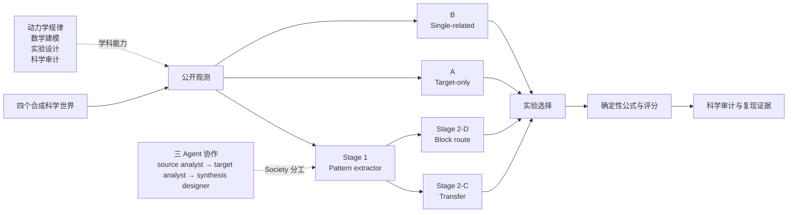

# Mini Science Society

Mini Science Society 是一套面向合成科学问题的可审计实验选择系统。系统把科学世界、候选实验、数学规律、Society 分工和证据审计连接成一条可复现流水线，支持单 Agent、顺序传递、三 Agent 协作与竞争四类工作模式。

## 快速入口

- [交互式学科与 Society 分工图](docs/society-map.html)
- [冻结协议](docs/PROTOCOL.md)
- [V5-P11 协议说明](docs/V5P11_PROTOCOL.md)
- [API 来源与迁移审计](docs/API_PROVENANCE.md)
- [研究限制与解释边界](docs/LIMITATIONS.md)

## 一分钟理解系统

系统围绕四个合成时间序列世界展开。每个世界包含 source 与 target 两类观测、四种候选机制和八个合法实验动作。Agent 依据公开观测、候选实验和阶段上下文选择下一步实验；程序依据确定性公式计算信息增益、动作分数、数值预测质量和路由证据。

```text
科学世界 → 公开观测 → Stage 1 规律提取 → Society 路由 → 实验选择 → 公式计算 → 证据审计
```

系统地图提供角色之间的空间关系、数据流和审计边界：

**[打开 Mini Science Society 系统地图](docs/society-map.html)**



## 学科版图

| 学科方向 | 核心对象 | 系统能力 | 关键证据 |
| --- | --- | --- | --- |
| 动力学规律 | source/target 时间序列、状态、时间尺度 | 识别 EXP_DECAY、HYPERBOLIC_DECAY、STRETCHED_EXP、BI_EXP 候选机制 | 世界 manifest 与公开观测 |
| 数学建模 | 参数、变量映射、候选方程 | 生成可计算预测、区分原始 Agent 数值与计算器诊断 | `public_calculator.py`、`prediction_audit.py` |
| 实验设计 | 八个实验动作、信息增益、目标候选 | 评价实验辨识价值并选择 Top-1 动作 | `ig_oracle.py`、`experiment_plan.py` |
| 科学审计 | 原始输出、严格有效性、费用、路由 | 分离科学结果、工程结果、账本和复现证据 | `analysis_v5p11.py`、`science_audit.py` |

### 四个科学世界

| 世界 | 结构特征 | 研究作用 |
| --- | --- | --- |
| IV001 | source/target 共享公开衰减尺度 | 共享规律识别场景 |
| IV002 | source 与 target 公开衰减尺度产生差异 | 跨域迁移敏感性场景 |
| IV003 | source/target 共享公开衰减尺度 | 重复验证场景 |
| IV004 | source 与 target 公开衰减尺度产生差异 | 规律识别与动作敏感性场景 |

所有世界采用 `v5p11_identifiable_world_v1`，观测单位、噪声水平、随机种子、候选机制和变量映射均写入版本化 manifest。

## Society 分工

### A/B 单 Agent

| 角色 | 输入范围 | 工作重点 |
| --- | --- | --- |
| A · Target-only | target 公开观测与实验菜单 | 直接设计目标域实验 |
| B · Single-related | source 公开观测、target 公开观测与实验菜单 | 综合相关 source 证据与 target 目标 |

### C/D 顺序 Society

| 阶段 | 角色 | 程序职责 |
| --- | --- | --- |
| Stage 1 | Pattern extractor | 从共享上下文提取规律、候选机制、证据ID和变量映射 |
| Stage 2-C | Question designer · transfer | 接收 Stage 1 原始对象，设计目标域实验 |
| Stage 2-D | Question designer · block | 接收同一 Stage 1 审计对象的中性占位，形成程序级信息阻断 |

C/D 使用同一份 Stage 1 对象。C 路由保留原始规律对象；D 路由保留阶段哈希与审计信息，同时把 Stage 2 输入置为中性占位。`route_shared_law_artifact()` 记录原始对象哈希、转发对象哈希、传递状态和干预类型。

### 三 Agent 协作与竞争

| 结构 | 角色链 | 产出 |
| --- | --- | --- |
| 协作 Society | source analyst → target analyst → synthesis designer | 两域分析、综合建议、最终实验设计 |
| 竞争 Society | proposer 1 + proposer 2 → evidence judge | 双方案、证据裁判、合法最终选择 |
| Oracle / Baseline | 信息增益 Oracle、固定 E04、随机策略、公开数学启发式 | 统一世界/重复索引的描述性参照 |

## 指标体系

| 指标 | 含义 | 统计口径 |
| --- | --- | --- |
| Information Gain | 实验对候选机制区分能力 | 冻结候选机制集合上的确定性计算 |
| Action Score | 所选实验对目标任务的得分 | 世界真值与合法菜单动作的评分函数 |
| Raw Agent Numeric Accuracy | Agent 原始预测的数值正确率 | 保留原始文本预测，按固定容差审计 |
| Calculator-assisted Diagnostic | 公开公式重算诊断 | 独立展示公式计算能力与 Agent 原始能力 |
| Strict Scientific Validity | 规律、变量、数值、动作全链路有效率 | 严格门槛下的科学有效行比例 |
| C−D Action Delta | 同世界同重复的行动差 | 完整C/D配对逐组计算，配对状态按实际覆盖记录 |

## 当前验收快照

当前工程收官验收形成以下可复核事实：

- 工程测试：182 项自动化测试通过。
- 世界校验：IV001–IV004 四世界通过。
- 真实调用账本：36 次唯一尝试、32 次完成、4 次进入异常状态或待审计状态。
- 科学条件覆盖：40 个条件槽位中的 26 个完成。
- C/D 完整配对：5 组，涉及 IV001、IV003、IV004。
- C/D 动作差：5 组均为 0；严格 C/D 数值差采用严格有效性口径。
- 选中实验平均信息增益：0.6416153260 nats。
- 平均动作分数：81.5520477211。
- 原始 Agent 数值正确率：4.81%。
- 严格科学有效率：0/26。
- Stage 1 关系识别：4/6；规律识别：2/6；变量映射：4/6。

这些数字代表当前合成任务的探索性证据。论文级结论需要更大的世界数量、更完整的配对覆盖和更稳定的数值输出。

## 安装与离线运行

```powershell
python -m pip install -e ".[dev]"
python -m pytest -q
python -m mini_science.cli generate --config config/pilot.json
python -m mini_science.cli validate-worlds --config config/pilot.json
python -m mini_science.cli smoke --provider mock --world W001
python -m mini_science.cli pilot --provider mock --worlds all --repeats 1
```

运行产物进入 `runs/`，报告进入对应 run 目录；Mock 结果携带测试夹具与专用证据标签。

## 分阶段验证入口

### v2 Gate 0

```powershell
python -m mini_science.cli generate --config config/pilot_v2.json
python -m mini_science.cli validate-worlds --config config/pilot_v2.json
python -m mini_science.cli plan --config config/pilot_v2.json
python -m mini_science.cli pilot --config config/pilot_v2.json --provider behavioral-mock --behavioral-scenario transfer_sensitive --worlds all --repeats 1
```

`behavioral-mock` 提供 `constant`、`transfer_sensitive`、`transfer_ignored`、`bad_stage1`、`bad_final` 和 `citation_leak` 场景，适用于路由、合同和科学审计回归测试。

### v3 Gate 1

```powershell
python -m mini_science.cli validate-worlds --config config/pilot_v2.json
python -m mini_science.cli audit-oracle --config config/pilot_v2.json --output reports/v2_oracle_audit.csv
python -m mini_science.cli pilot --config config/pilot_v2.json --provider behavioral-mock --behavioral-scenario transfer_sensitive --worlds W001 --conditions A_TARGET_ONLY,B_SINGLE_RELATED,C_SEQ2_TRANSFER,D_SEQ2_BLOCK --run-dir runs/v3_offline_behavioral_control
```

### 真实API Gate

真实API入口采用显式参数、阶段授权、模型校验、请求预算、成本门禁和零自动重试策略。默认配置 `config/real_gate_v3.json` 提供初始授权状态与零调用额度；操作员通过授权记录开启指定实验范围。

```powershell
python -m mini_science.cli check-api --provider kimi26 --allow-paid-api --max-calls 1 --kimi26-key-file E:\\master_exp\\nature_prj1_cal\\from_llm_to_agent\\api_key\\kimi\\kimi-k2.6.txt --kimi26-max-cost-usd 0.10
```

密钥通过本地文件或环境变量注入，示例配置提供变量名与调用边界；版本库提交范围聚焦源码、测试、合成世界和公开协议。

## 项目结构

```text
config/                 冻结配置与实验门禁
data/                   版本化合成科学世界
docs/                   协议、来源、限制与系统地图
src/mini_science/       核心引擎、适配器、Society、评分与审计
scripts/                世界生成、提案、离线分析与证据工具
tests/                  工程、协议、路由、预算和科学指标测试
mini_science_society/   早期可运行子项目快照
```

## 研究定位

Mini Science Society 聚焦三个工程问题：实验选择能否被确定性评价，规律对象能否沿指定 Society 路由传递，结果能否以原始证据、严格指标和费用账本复现。所有科学结论绑定到版本化世界、冻结候选机制、明确条件和实际证据覆盖。

## 开发约定

1. 新实验使用全局唯一 request ID 与独立 run 目录。
2. 原始响应、失败状态、费用字段和缺失配对保持可追溯。
3. C/D 使用共享 Stage 1 对象与程序级路由干预。
4. 计算器诊断与 Agent 原始预测分栏统计。
5. 测试、世界验证和证据审计随版本一起运行。

## 许可与贡献

欢迎围绕合成科学世界、可审计 Society 路由、确定性评分和复现工具提交改进。贡献内容配套测试、数据来源说明和运行命令，研究解释保持与证据覆盖一致。
